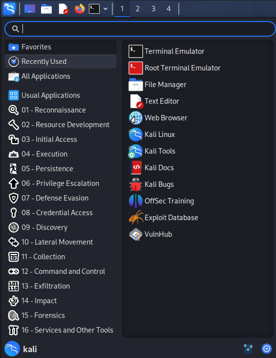
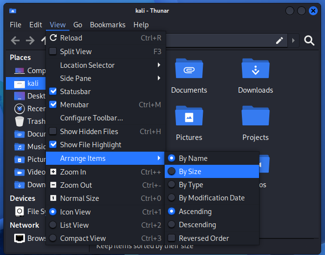
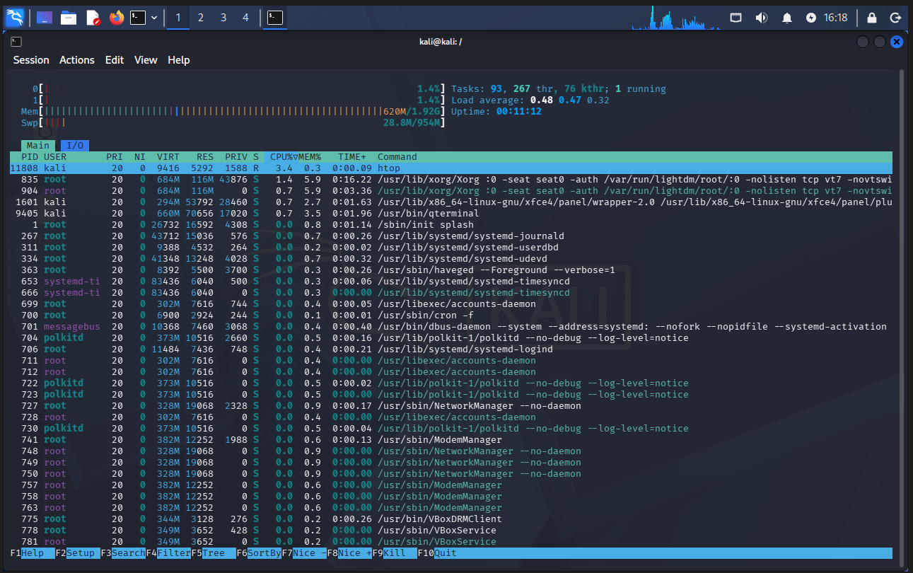
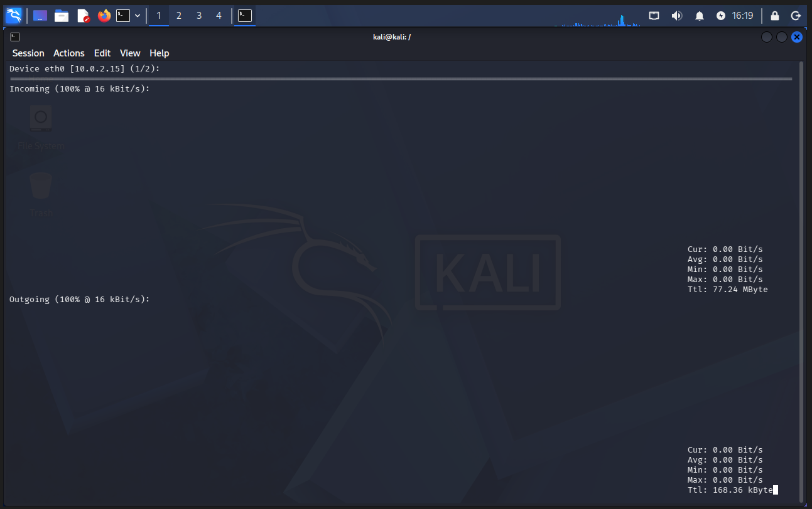

# LAB 01 - Introduction to Kali Linux

## 1️⃣ Introduction

The goal of the exercise is for us as users to learn how to: ✅ understand the purpose and role of Kali Linux in cybersecurity ✅ get to know the basic graphical and command environment of Kali Linux ✅ find and run some key tools ✅ execute basic commands and analyze the results

## 2️⃣ Working with Kali Linux

### 1️⃣ Installing Kali Linux


### 2️⃣ Starting the Kali Linux environment

### Find the security tools menu and review the 5 tools you find.
In my edition of the Kali Linux there was no security tools menu.



### find operating system settings


### sort file system


### 3️⃣ Basic Command Line Commands

```bash
┌──(kali㉿kali)-[~]
└─$ whoami
kali
                                                                                                                                                            
┌──(kali㉿kali)-[~]
└─$ hostnamectl
 Static hostname: kali
       Icon name: computer-vm
         Chassis: vm 💽
      Machine ID: b0ed7c0ca88a4c3694200ec9c6bbfe4e
         Boot ID: a6e747981a5a4e5288da991d1351c611
  Virtualization: oracle
Operating System: Kali GNU/Linux Rolling   
          Kernel: Linux 7.1.5+kali-amd64
    Architecture: x86-64
 Hardware Vendor: innotek GmbH
  Hardware Model: VirtualBox
Hardware Version: 1.2
Firmware Version: VirtualBox
   Firmware Date: Fri 2006-12-01
    Firmware Age: 19y 11month 2w 4d   

┌──(kali㉿kali)-[~]
└─$ uname -a
Linux kali 7.1.5+kali-amd64 #1 SMP PREEMPT_DYNAMIC Kali 7.1.5-1kali1 (2026-07-29) x86_64 GNU/Linux

┌──(kali㉿kali)-[~]
└─$ df -h
Filesystem      Size  Used Avail Use% Mounted on
udev            943M     0  943M   0% /dev
tmpfs           197M  980K  196M   1% /run
/dev/sda1        79G   17G   59G  22% /
tmpfs           985M  4.0K  985M   1% /dev/shm
none            1.0M     0  1.0M   0% /run/credentials/systemd-journald.service
tmpfs           985M  8.0K  985M   1% /tmp
none            1.0M     0  1.0M   0% /run/credentials/getty@tty1.service
tmpfs           197M  112K  197M   1% /run/user/1000
                                                                                                                                                            
┌──(kali㉿kali)-[~]
└─$ ip a
1: lo: <LOOPBACK,UP,LOWER_UP> mtu 65536 qdisc noqueue state UNKNOWN group default qlen 1000
    link/loopback 00:00:00:00:00:00 brd 00:00:00:00:00:00
    inet 127.0.0.1/8 scope host lo
       valid_lft forever preferred_lft forever
    inet6 ::1/128 scope host noprefixroute 
       valid_lft forever preferred_lft forever
2: eth0: <BROADCAST,MULTICAST,UP,LOWER_UP> mtu 1500 qdisc fq_codel state UP group default qlen 1000
    link/ether 08:00:27:c3:fb:76 brd ff:ff:ff:ff:ff:ff
    inet 10.0.2.15/24 brd 10.0.2.255 scope global dynamic noprefixroute eth0
       valid_lft 85899sec preferred_lft 85899sec
    inet6 fd17:625c:f037:2:a4bd:ce77:c375:978c/64 scope global dynamic noprefixroute 
       valid_lft 85901sec preferred_lft 13901sec
    inet6 fe80::c49c:3cea:3e43:618/64 scope link noprefixroute 
       valid_lft forever preferred_lft forever

┌──(kali㉿kali)-[~]
└─$ wget https://gist.githubusercontent.com/EdwardRayl/3436572afde8ce9e3faf5b7b95356a49/raw/6b25895fce480713560829dec31ac8220ffe5272/gists.txt 

--2026-11-18 16:16:33--  https://gist.githubusercontent.com/EdwardRayl/3436572afde8ce9e3faf5b7b95356a49/raw/6b25895fce480713560829dec31ac8220ffe5272/gists.txt
Resolving gist.githubusercontent.com (gist.githubusercontent.com)... 185.199.109.133, 185.199.108.133, 185.199.111.133, ...
Connecting to gist.githubusercontent.com (gist.githubusercontent.com)|185.199.109.133|:443... connected.
HTTP request sent, awaiting response... 200 OK
Length: 9634 (9.4K) [text/plain]
Saving to: ‘gists.txt’

gists.txt                              100%[============================================================================>]   9.41K  --.-KB/s    in 0.001s  

2026-11-18 16:16:33 (16.5 MB/s) - ‘gists.txt’ saved [9634/9634]

┌──(kali㉿kali)-[~]
└─$ sudo apt install 7zip
[sudo] password for kali: 
7zip is already the newest version (26.02+dfsg-2).
7zip set to manually installed.
Summary:                    
  Upgrading: 0, Installing: 0, Removing: 0, Not Upgrading: 0

┌──(kali㉿kali)-[~]
└─$ which nmap                                                                                                                                
/usr/bin/nmap
                                                                                                                                                            
┌──(kali㉿kali)-[~]
└─$ which john 
/usr/sbin/john
                                                                                                                                                            
┌──(kali㉿kali)-[~]
└─$ cd / 
                                                                                                                                                            
┌──(kali㉿kali)-[/]
└─$ ls -la
total 976640
drwxr-xr-x  18 root root       4096 Oct  9 14:07 .
drwxr-xr-x  18 root root       4096 Oct  9 14:07 ..
lrwxrwxrwx   1 root root          7 Sep  9 23:51 bin -> usr/bin
drwxr-xr-x   3 root root       4096 Oct  9 14:07 boot
drwxr-xr-x  18 root root       3240 Nov 18 16:07 dev
drwxr-xr-x 186 root root      12288 Nov 18 16:07 etc
drwxr-xr-x   3 root root       4096 Oct  9 13:41 home
lrwxrwxrwx   1 root root         32 Oct  9 14:07 initrd.img -> boot/initrd.img-7.1.5+kali-amd64
lrwxrwxrwx   1 root root         32 Oct  9 14:07 initrd.img.old -> boot/initrd.img-7.1.5+kali-amd64
lrwxrwxrwx   1 root root          7 Sep  9 23:51 lib -> usr/lib
lrwxrwxrwx   1 root root          9 Oct  9 13:38 lib32 -> usr/lib32
lrwxrwxrwx   1 root root          9 Sep  9 23:51 lib64 -> usr/lib64
drwx------   2 root root      16384 Oct  9 14:06 lost+found
drwxr-xr-x   2 root root       4096 Oct  9 13:34 media
drwxr-xr-x   2 root root       4096 Oct  9 13:34 mnt
drwxr-xr-x   3 root root       4096 Oct  9 13:38 opt
dr-xr-xr-x 189 root root          0 Nov 18 16:07 proc
drwx------   4 root root       4096 Nov 18 16:07 root
drwxr-xr-x  40 root root        940 Nov 18 16:07 run
lrwxrwxrwx   1 root root          8 Sep  9 23:51 sbin -> usr/sbin
drwxr-xr-x   3 root root       4096 Oct  9 13:39 srv
-rw-------   1 root root 1000000000 Oct  9 14:07 swap
dr-xr-xr-x  13 root root          0 Nov 18 16:07 sys
drwxrwxrwt  12 root root        320 Nov 18 16:17 tmp
drwxr-xr-x  15 root root       4096 Oct  9 13:38 usr
drwxr-xr-x  12 root root       4096 Nov 18 16:07 var
lrwxrwxrwx   1 root root         29 Oct  9 14:07 vmlinuz -> boot/vmlinuz-7.1.5+kali-amd64
lrwxrwxrwx   1 root root         29 Oct  9 14:07 vmlinuz.old -> boot/vmlinuz-7.1.5+kali-amd64
```

#### htop


#### traceroute

```bash
┌──(kali㉿kali)-[/]
└─$ traceroute google.com
traceroute to google.com (192.178.194.101), 30 hops max, 60 byte packets
 1  10.0.2.2 (10.0.2.2)  1.187 ms  1.105 ms  1.033 ms
 2  10.0.2.2 (10.0.2.2)  21.375 ms  21.260 ms  21.188 ms
```

#### nload



#### strings

```bash
┌──(kali㉿kali)-[/]
└─$ strings /bin/ls | head
t/lib64/ld-linux-x86-64.so.2
_ITM_deregisterTMCloneTable
__gmon_start__
_ITM_registerTMCloneTable
fgetfilecon_raw
fgetfilecon
freecon
lgetfilecon
lgetfilecon_raw
optind

```

### 3️⃣ Using tools in Kali Linux

#### tcpdump

```bash
┌──(kali㉿kali)-[/]
└─$ sudo tcpdump -c 10            
tcpdump: verbose output suppressed, use -v[v]... for full protocol decode
listening on eth0, link-type EN10MB (Ethernet), snapshot length 262144 bytes
16:23:19.006846 IP 192.168.1.13.33821 > 10.0.2.15.50696: UDP, length 84
16:23:19.006871 IP 10.0.2.15 > 192.168.1.13: ICMP 10.0.2.15 udp port 50696 unreachable, length 120
16:23:19.049729 IP 10.0.2.15.56446 > InnboxG92.domain: 18596+ PTR? 15.2.0.10.in-addr.arpa. (40)
16:23:19.061307 IP InnboxG92.domain > 10.0.2.15.56446: 18596 NXDomain* 0/1/0 (90)
16:23:19.061939 IP 10.0.2.15.38990 > InnboxG92.domain: 22643+ PTR? 13.1.168.192.in-addr.arpa. (43)
16:23:19.071978 IP InnboxG92.domain > 10.0.2.15.38990: 22643 NXDomain* 0/0/0 (43)
16:23:19.141096 IP 10.0.2.15.35825 > InnboxG92.domain: 52698+ PTR? 1.1.168.192.in-addr.arpa. (42)
16:23:19.143931 IP InnboxG92.domain > 10.0.2.15.35825: 52698* 1/0/0 PTR InnboxG92. (65)
16:23:24.006975 IP 192.168.1.13.35161 > 10.0.2.15.50696: UDP, length 84
16:23:24.006997 IP 10.0.2.15 > 192.168.1.13: ICMP 10.0.2.15 udp port 50696 unreachable, length 120
10 packets captured
10 packets received by filter
0 packets dropped by kernel
```

#### nmap

```bash
┌──(kali㉿kali)-[~]
└─$ nmap -O 192.168.1.10
Starting Nmap 7.99 ( https://nmap.org ) at 2026-11-18 16:24 -0500
Nmap scan report for 192.168.1.10
Host is up (0.0061s latency).
Not shown: 995 closed tcp ports (reset)
PORT     STATE SERVICE
21/tcp   open  ftp
22/tcp   open  ssh
80/tcp   open  http
443/tcp  open  https
5357/tcp open  wsdapi
Device type: VoIP adapter|bridge|general purpose
Running (JUST GUESSING): AT&T embedded (89%), Oracle Virtualbox (88%), Slirp (88%), QEMU (85%)
OS CPE: cpe:/o:oracle:virtualbox cpe:/a:danny_gasparovski:slirp cpe:/a:qemu:qemu
Aggressive OS guesses: AT&T BGW210 voice gateway (89%), Oracle Virtualbox Slirp NAT bridge (88%), QEMU user mode network gateway (85%)
No exact OS matches for host (test conditions non-ideal).

OS detection performed. Please report any incorrect results at https://nmap.org/submit/ .
Nmap done: 1 IP address (1 host up) scanned in 59.66 seconds

```

```bash

```

```bash
┌──(kali㉿kali)-[~]
└─$ nmap -sS -T4 192.168.1.10              
Starting Nmap 7.99 ( https://nmap.org ) at 2026-11-18 16:33 -0500
Warning: 192.168.1.10 giving up on port because retransmission cap hit (6).
Nmap scan report for 192.168.1.10
Host is up (0.11s latency).
Not shown: 995 closed tcp ports (reset)
PORT     STATE SERVICE
21/tcp   open  ftp
22/tcp   open  ssh
80/tcp   open  http
443/tcp  open  https
5357/tcp open  wsdapi

Nmap done: 1 IP address (1 host up) scanned in 161.13 seconds
```

#### searchsploit

```bash
┌──(kali㉿kali)-[~]
└─$ searchsploit wordpress ftp
-------------------------------------------------------------------------------------------------------------------------- ---------------------------------
 Exploit Title                                                                                                            |  Path
-------------------------------------------------------------------------------------------------------------------------- ---------------------------------
WordPress Plugin MiwoFTP 1.0.5 - Arbitrary File Download (1)                                                              | php/webapps/36774.txt
WordPress Plugin MiwoFTP 1.0.5 - Arbitrary File Download (2)                                                              | php/webapps/36801.txt
WordPress Plugin MiwoFTP 1.0.5 - Cross-Site Request Forgery / Arbitrary File Creation / Remote Code Execution             | php/webapps/36763.txt
WordPress Plugin MiwoFTP 1.0.5 - Cross-Site Request Forgery / Arbitrary File Deletion                                     | php/webapps/36761.txt
WordPress Plugin MiwoFTP 1.0.5 - Multiple Cross-Site Request Forgery / Cross-Site Scripting Vulnerabilities               | php/webapps/36762.txt
-------------------------------------------------------------------------------------------------------------------------- ---------------------------------
Shellcodes: No Results

```

#### dnsenum

```bash
┌──(kali㉿kali)-[~]
└─$ searchsploit wordpress ftp
-------------------------------------------------------------------------------------------------------------------------- ---------------------------------
 Exploit Title                                                                                                            |  Path
-------------------------------------------------------------------------------------------------------------------------- ---------------------------------
WordPress Plugin MiwoFTP 1.0.5 - Arbitrary File Download (1)                                                              | php/webapps/36774.txt
WordPress Plugin MiwoFTP 1.0.5 - Arbitrary File Download (2)                                                              | php/webapps/36801.txt
WordPress Plugin MiwoFTP 1.0.5 - Cross-Site Request Forgery / Arbitrary File Creation / Remote Code Execution             | php/webapps/36763.txt
WordPress Plugin MiwoFTP 1.0.5 - Cross-Site Request Forgery / Arbitrary File Deletion                                     | php/webapps/36761.txt
WordPress Plugin MiwoFTP 1.0.5 - Multiple Cross-Site Request Forgery / Cross-Site Scripting Vulnerabilities               | php/webapps/36762.txt
-------------------------------------------------------------------------------------------------------------------------- ---------------------------------
Shellcodes: No Results
                                                                                                                                                            
┌──(kali㉿kali)-[~]
└─$ dnsenum google.com
dnsenum VERSION:1.3.1

-----   google.com   -----


Host's addresses:
__________________

google.com.                              217      IN    A        192.178.194.100
google.com.                              217      IN    A        192.178.194.102
google.com.                              217      IN    A        192.178.194.139
google.com.                              217      IN    A        192.178.194.138
google.com.                              217      IN    A        192.178.194.101
google.com.                              217      IN    A        192.178.194.113


Name Servers:
______________

ns4.google.com.                          175      IN    A        216.239.38.10
ns1.google.com.                          300      IN    A        216.239.32.10
ns3.google.com.                          300      IN    A        216.239.36.10
ns2.google.com.                          300      IN    A        216.239.34.10


Mail (MX) Servers:
___________________                                                                                                                                         
                                                                                                                                                            
smtp.google.com.                         300      IN    A        142.251.127.26                                                                             
smtp.google.com.                         300      IN    A        142.251.127.27

                                                                                                                                                            
Trying Zone Transfers and getting Bind Versions:                                                                                                            
_________________________________________________                                                                                                           
                                                                                                                                                            
                                                                                                                                                            
Trying Zone Transfer for google.com on ns4.google.com ... 
AXFR record query failed: corrupt packet

Trying Zone Transfer for google.com on ns3.google.com ... 
AXFR record query failed: corrupt packet

Trying Zone Transfer for google.com on ns1.google.com ... 
AXFR record query failed: corrupt packet

Trying Zone Transfer for google.com on ns2.google.com ... 
AXFR record query failed: corrupt packet
```

#### lbd

```bash
┌──(kali㉿kali)-[~]
└─$ lbd google.com

lbd - load balancing detector 0.4 - Checks if a given domain uses load-balancing.
                                    Written by Stefan Behte (http://ge.mine.nu)
                                    Proof-of-concept! Might give false positives.

Checking for DNS-Loadbalancing: FOUND
google.com has address 192.178.194.113
google.com has address 192.178.194.101
google.com has address 192.178.194.102
google.com has address 192.178.194.138
google.com has address 192.178.194.139
google.com has address 192.178.194.100

Checking for HTTP-Loadbalancing [Server]: 
 gws
 NOT FOUND

Checking for HTTP-Loadbalancing [Date]: 21:29:21, 21:29:22, 21:29:22, 21:29:22, 21:29:23, 21:29:23, 21:29:23, 21:29:24, 21:29:24, 21:29:24, 21:29:25, 21:29:25, 21:29:26, 21:29:26, 21:29:26, 21:29:27, 21:29:27, 21:29:27, 21:29:28, 21:29:28, 21:29:28, 21:29:29, 21:29:29, 21:29:29, 21:29:30, 21:29:30, 21:29:30, 21:29:31, 21:29:31, 21:29:31, 21:29:32, 21:29:32, 21:29:32, 21:29:33, 21:29:33, 21:29:34, 21:29:34, 21:29:34, 21:29:35, 21:29:35, 21:29:35, 21:29:36, 21:29:36, 21:29:36, 21:29:37, 21:29:37, 21:29:37, 21:29:38, 21:29:38, 21:29:38, NOT FOUND

Checking for HTTP-Loadbalancing [Diff]: FOUND
< Content-Security-Policy-Report-Only: object-src 'none';base-uri 'self';script-src 'nonce-DT8OVIgrvc7FfJHVsTMX2Q' 'strict-dynamic' 'report-sample' 'unsafe-eval' 'unsafe-inline' https: http:;report-uri https://csp.withgoogle.com/csp/gws/other-hp
> Content-Security-Policy-Report-Only: object-src 'none';base-uri 'self';script-src 'nonce-bcSYOIkyrp8GMzSFK2kyXQ' 'strict-dynamic' 'report-sample' 'unsafe-eval' 'unsafe-inline' https: http:;report-uri https://csp.withgoogle.com/csp/gws/other-hp

google.com does Load-balancing. Found via Methods: DNS HTTP[Diff]
```

#### nth

```bash
┌──(kali㉿kali)-[~]
└─$ nth -t ef487f75307f96954d3bb132e5f4b035
  _   _                           _____ _           _          _   _           _     
 | \ | |                         |_   _| |         | |        | | | |         | |    
 |  \| | __ _ _ __ ___   ___ ______| | | |__   __ _| |_ ______| |_| | __ _ ___| |__  
 | . ` |/ _` | '_ ` _ \ / _ \______| | | '_ \ / _` | __|______|  _  |/ _` / __| '_ \ 
 | |\  | (_| | | | | | |  __/      | | | | | | (_| | |_       | | | | (_| \__ \ | | |
 \_| \_/\__,_|_| |_| |_|\___|      \_/ |_| |_|\__,_|\__|      \_| |_/\__,_|___/_| |_|

https://twitter.com/bee_sec_san
https://github.com/HashPals/Name-That-Hash 
    

ef487f75307f96954d3bb132e5f4b035

Most Likely 
MD5, HC: 0 JtR: raw-md5 Summary: Used for Linux Shadow files.
MD4, HC: 900 JtR: raw-md4
NTLM, HC: 1000 JtR: nt Summary: Often used in Windows Active Directory.
Domain Cached Credentials, HC: 1100 JtR: mscach

Least Likely
Domain Cached Credentials 2, HC: 2100 JtR: mscach2 Double MD5, HC: 2600  Tiger-128,  Skein-256(128),  Skein-512(128),  Lotus Notes/Domino 5, HC: 8600 JtR: 
lotus5 md5(md5(md5($pass))), HC: 3500 Summary: Hashcat mode is only supported in hashcat-legacy. md5(uppercase(md5($pass))), HC: 4300  md5(sha1($pass)), HC:
4400  md5(utf16($pass)), JtR: dynamic_29 md4(utf16($pass)), JtR: dynamic_33 md5(md4($pass)), JtR: dynamic_34 Haval-128, JtR: haval-128-4 RIPEMD-128, JtR: 
ripemd-128 MD2, JtR: md2 Snefru-128, JtR: snefru-128 DNSSEC(NSEC3), HC: 8300  RAdmin v2.x, HC: 9900 JtR: radmin Cisco Type 7,  BigCrypt, JtR: bigcrypt 

```

## 3️⃣ Reflection and Analysis

###  Why do we use Kali Linux? What is the advantage of Kali Linux compared to other Linux distributions? • Which features and tools of Kali Linux attracted you the most?

We use Kali Linux mainly for cybersecurity, penetration testing and digital forensics. Its biggest advantage over other Linux distributions is that it comes preinstalled with hundreds of security tools, making it easier to perform different security tests without manually installing and configuring everything.

The tools that attracted me the most are **Nmap** for network scanning, **aircrack** for cracking WiFi passwords, and **autopsy** and **bulk_extractor** for digital forensics.